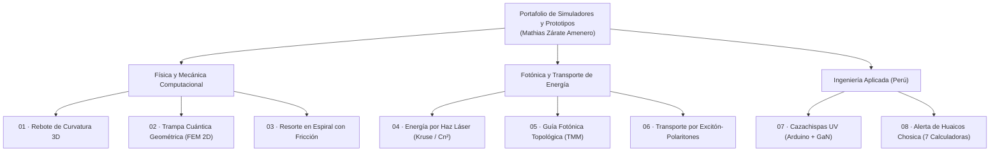

# Simuladores y Prototipos — Portafolio de Física e Ingeniería

---

## 🎯 Presentación

Bienvenido a mi colección de **simuladores computacionales, modelos físicos e informes de ingeniería**. Este portafolio reúne **8 proyectos independientes**, cada uno con su propio **simulador interactivo ejecutable en el navegador** y su **documento técnico de respaldo**:

- 🔬 **6 exploraciones teóricas y computacionales en física/fotónica/mecánica:** modelos de juguete con supuestos explícitos, métodos numéricos (FEM 2D, matrices de transferencia, elástica no lineal con fricción, caminatas aleatorias persistentes) y análisis crítico frente a la literatura científica.
- ⚡ **1 prototipo electrónico de seguridad eléctrica (Arduino + Física del Estado Sólido/QED):** detector óptico-eléctrico de arcos por fotones UV ($337\text{ nm}$).
- 🏔️ **1 banco de ingeniería civil/instrumentación para prevención de desastres en Perú:** rediseño de un sistema de alerta temprana de huaicos mediante densidad aparente basal + radar.

> [!NOTE]
> **Transparencia metodológica:** Ninguno de estos repositorios reclama resultados experimentales propios cerrados; todos declaran abiertamente las ecuaciones empleadas, el alcance del modelo numérico y sus limitaciones físicas o de ingeniería.

---

## 🚀 Catálogo Completo de Proyectos

### I. Física Teórica, Cuántica y Mecánica Computacional

| # | Proyecto | Área / Método Numérico | Simulador en Línea | Repositorio y Documentación |
| :---: | :--- | :--- | :---: | :---: |
| **01** | **Analogía de la bola de papel arrugado (v2.2)** *Rebote de curvatura acumulada y asimetría entre ejes* | Sistemas Dinámicos 3D · Paisaje de curvatura $\kappa(t)$ vs. umbral $\Gamma(\delta)$ | [🎮 **Abrir Simulador 3D**](https://mathigza1211.github.io/analogia-rebote-curvatura/) [📄 Informe Web](https://mathigza1211.github.io/analogia-rebote-curvatura/informe-investigacion.html) | [📦 `analogia-rebote-curvatura`](https://github.com/mathigza1211/analogia-rebote-curvatura) |
| **02** | **Trampa de curvatura cuántica (v1.5)** *Confinamiento geométrico en guía espiral sin barreras adicionales* | Mecánica Cuántica · Elementos Finitos 2D (métrica polar exacta) + Kronig–Penney | [🎮 **Abrir Simulador**](https://mathigza1211.github.io/trampa-de-curvatura/) | [📦 `trampa-de-curvatura`](https://github.com/mathigza1211/trampa-de-curvatura) |
| **03** | **Resorte de torsión en espiral (v1.4)** *Curva par-giro no lineal con contacto entre espiras y adhesión* | Mecánica de Sólidos · Elástica de viga + Contacto por penalización + Coulomb | [🎮 **Abrir Simulador**](https://mathigza1211.github.io/resorte-torsion-espiral/) | [📦 `resorte-torsion-espiral`](https://github.com/mathigza1211/resorte-torsion-espiral) |

---

### II. Fotónica, Óptica Atmosférica y Transporte de Energía

| # | Proyecto | Área / Método Numérico | Simulador en Línea | Repositorio y Documentación |
| :---: | :--- | :--- | :---: | :---: |
| **04** | **Transporte de energía por haz dirigido (v1.1)** *Cadena completa de pérdidas de un enlace láser (Power Beaming)* | Óptica Atmosférica · Haz Gaussiano + Extinción de Kruse + Turbulencia $C_n^2$ | [🎮 **Abrir Simulador**](https://mathigza1211.github.io/energia-haz-dirigido/) | [📦 `energia-haz-dirigido`](https://github.com/mathigza1211/energia-haz-dirigido) |
| **05** | **Guía fotónica topológica vs. rugosidad (v1.1)** *¿Protege realmente contra la retrodispersión en régimen de luz lenta?* | Fotónica Integrada · Matrices de Transferencia Aleatorias + Localización 1D | [🎮 **Abrir Simulador**](https://mathigza1211.github.io/energia-guia-fotonica-topologica/) | [📦 `energia-guia-fotonica-topologica`](https://github.com/mathigza1211/energia-guia-fotonica-topologica) |
| **06** | **Polaritones para mover excitaciones (v1.1)** *Transporte híbrido luz–materia más allá del límite difusivo del excitón* | Óptica Cuántica · Coeficientes de Hopfield + Caminata Aleatoria Persistente | [🎮 **Abrir Simulador**](https://mathigza1211.github.io/energia-polaritones/) | [📦 `energia-polaritones`](https://github.com/mathigza1211/energia-polaritones) |

---

### III. Prototipos de Ingeniería Aplicada y Prevención de Riesgos

| # | Proyecto | Área / Aplicación | Simulador en Línea | Repositorio y Documentación |
| :---: | :--- | :--- | :---: | :---: |
| **07** | **Cazachispas UV: detector de arcos eléctricos** *Detección temprana de incendios eléctricos por fotones UV ($337\text{ nm}$) y corriente* | Electrónica Embebida (Arduino `.ino`) + Física de Semiconductores ($\text{GaN}$, $3.4\text{ eV}$) | [🎮 **Abrir Simulador**](https://mathigza1211.github.io/cazachispas-uv/) | [📦 `cazachispas-uv`](https://github.com/mathigza1211/cazachispas-uv) |
| **08** | **Presión Cuántica v2: alerta de huaicos** *Banco de 7 calculadoras de ingeniería para la quebrada San Antonio de Pedregal (Chosica)* | Ingeniería Geotécnica, Hidráulica, Radioenlace, Monte Carlo y Túnel Fowler–Nordheim | [🎮 **Abrir Suite (7 Calculadoras)**](https://mathigza1211.github.io/presion-cuantica-huaicos/) | [📦 `presion-cuantica-huaicos`](https://github.com/mathigza1211/presion-cuantica-huaicos) |

---

## 🗺️ Mapa del Portafolio

---

## 👤 Autoría

**Mathias Zárate Amenero**  
📍 *Lima, Perú*  
Desarrollado con asistencia de **Claude (Anthropic)**.
